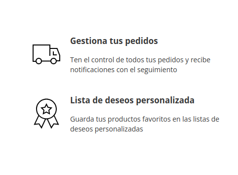

<div align="center">

# PCCOMPONENTES

**Tienda de componentes de PC** — React en el front, Express + MongoDB en el back,
con registro, verificación por email y login social con Google OAuth 2.0.



</div>

---

## Qué hace

Una tienda online de componentes de PC con dos zonas:

- **Zona pública**: catálogo, categorías y contacto.
- **Zona de cliente**: registro, inicio de sesión, verificación de email y
  acceso con cuenta de Google.

En la parte técnica, lo interesante no es el catálogo: es **cómo se gestiona la
sesión** de principio a fin, y por qué el `401` se distingue del "credenciales
incorrectas" del "tu token ha caducado".

## ✨ Funcionalidades

| | |
| --- | --- |
| 🔐 | Registro e inicio de sesión con **JWT (Bearer)** y contraseñas cifradas con **BCrypt** |
| 📧 | Verificación de email con enlace de un solo uso y caducidad (15 min) |
| 🔵 | Login social con **Google OAuth 2.0** |
| 🛡️ | Protección anti-spam con **Cloudflare Turnstile** + *honeypot* |
| 🗂️ | Catálogo por categorías (MongoDB + Mongoose) |
| 🧭 | Enrutado con **React Router** y estado global con **Zustand** |
| 🎨 | **Bootstrap 5** y diseño *responsive* |
| 🧪 | Validación en cliente **y** en servidor, con mensajes de error en español |
| ⚙️ | Configuración por variables de entorno; **ningún secreto en el código** |

## 🛠️ Stack

**Front**
```
React 19 · Vite · React Router · Zustand · Bootstrap 5
```

**Back**
```
Node.js · Express 5 · Mongoose · MongoDB · JWT · BCrypt · Mailjet · Google OAuth 2.0
```

## 🚀 Cómo ejecutarlo

### Requisitos
- **Node.js 20+**
- **MongoDB** en local (o una URI de MongoDB Atlas)

### 1. Dependencias

```bash
# front
npm install

# back
cd server
npm install
```

### 2. Variables de entorno

```bash
cd server
cp .env.example .env
```

Rellena al menos estas tres:

```env
PORT=3000
MONGO_URI=mongodb://localhost:27017/pccomponentes
JWT_SECRET=<genera uno con: node -e "console.log(require('crypto').randomBytes(48).toString('hex'))">
```

Las demás (`MAILJET_*`, `GOOGLE_OAUTH_*`) son para el email de verificación y el
login con Google. El proyecto **arranca igual sin ellas**: solo se omiten esas
funcionalidades.

> ⚠️ `.env` está en `.gitignore`. Nunca se sube.

### 3. Datos de ejemplo y arranque

```bash
cd server
npm run seed     # inserta las 4 categorías (es idempotente)
npm run dev      # API en http://localhost:3000
```

```bash
# en otra terminal, desde la raíz
npm run dev      # front en http://localhost:5173
```

El front usa un **proxy de Vite** (`/api` → `localhost:3000`), así que en el
navegador todo es del mismo origen y no hay problemas de CORS.

## 🔌 API

| Método | Ruta | Auth | Qué hace |
| --- | --- | --- | --- |
| `GET` | `/api/health` | — | Health check |
| `POST` | `/api/auth/register` | — | Registra un usuario y le manda el email de verificación |
| `POST` | `/api/auth/login` | — | Inicia sesión y devuelve el token |
| `GET` | `/api/auth/verificar?token=` | — | Confirma la cuenta (enlace de un solo uso) |
| `GET` | `/api/categorias` | ✅ | Lista las categorías |
| `POST` | `/api/Cliente/Registro` | — | Registro (ruta antigua, estilo de clase) |
| `GET` | `/api/Cliente/LoginGoogle` | — | Genera la URL de autorización de Google |
| `GET` | `/api/Cliente/LoginGoogleCallBack` | — | Callback de OAuth: canjea el código por un token |

Los errores de la API tienen siempre la misma forma:

```json
{ "error": { "codigo": "TOKEN_CADUCADO", "mensaje": "Tu sesión ha caducado." } }
```

## 🗂️ Estructura

```
├── src/                     # front (React)
│   ├── Componentes/
│   │   ├── ZonaTienda/      # catálogo, layout, header
│   │   ├── zonaCliente/     # login, registro, verificación
│   │   └── error/
│   ├── store/               # Zustand: sesión (persistida en localStorage)
│   ├── stateGlobal/         # Zustand: estado en curso (carrito, tokens)
│   └── utils/               # apiFetch (wrapper de fetch con JWT) y validaciones
│
├── server/                  # back (Express)
│   └── src/
│       ├── routes/          # auth, categorias, clientes
│       ├── middleware/      # requiereAuth (JWT), validaciones, errores
│       ├── models/          # esquemas de Mongoose
│       ├── config/          # conexión a BD y cliente de correo
│       ├── mail/            # envío de emails
│       └── seed/            # datos iniciales
│
└── docs/                    # notas de sesión: qué se hizo y por qué
```

## 🔐 Decisiones de seguridad que meFactories

**1. El login no dice si el email existe.** Un mismo error y un mismo `codigo`
(`CREDENCIALES`) para "no existe" y "contraseña incorrecta". Si se distinguieran,
cualquiera podría descubrir qué emails tienen cuenta en la tienda: sería un
**oráculo**.

**2. Un `401` no significa siempre lo mismo.** El backend distingue con el
`codigo` del error:

| `codigo` | Significa | ¿Se cierra sesión? |
| --- | --- | --- |
| `CREDENCIALES` | El usuario se ha equivocado al entrar | **No** — está intentando *entrar* |
| `TOKEN_CADUCADO` / `TOKEN_INVALIDO` | La sesión ya no vale | **Sí** |
| (sin `codigo`) | No se sabe | **Sí** — se cierra por si acaso |

Es un **fail closed**: cuando no sabes si la sesión sigue viva, la cierras.

**3. El cuerpo de un error se lee una sola vez.** Para mirar el `codigo` sin
quedarte sin el mensaje que necesita el usuario, la respuesta se **clona** antes
de leerla:

```js
const data = await res.clone().json().catch(() => null);
```

`clone()` reparte los datos, no los resucita: hay que clonarlo **antes** de la
primera lectura.

**4. Nunca se manda el stack trace al cliente.** En el middleware de errores, un
`500` devuelve `"Error del servidor"`. Un stack trace es un mapa de tu sistema de
ficheros regalado a cualquiera que lo lea.

## 📚 Documentación

- [`docs/NOTA-SESION-BACKEND.md`](./docs/NOTA-SESION-BACKEND.md) — cómo se montó
  el backend, la configuración y el arranque.
- [`docs/NOTA-401-Y-GUARDA-SESION.md`](./docs/NOTA-401-Y-GUARDA-SESION.md) — el
  bug de las dos fuentes de verdad para la sesión, y cómo se resolvió.

## 🚧 Estado

En desarrollo. Pendiente:

- [ ] Catálogo de productos real (solo hay categorías)
- [ ] Carrito y pedidos
- [ ] Terminar el *callback* de Google OAuth (devuelve los datos del usuario pero
      todavía no inicia sesión)
- [ ] Tests automatizados

---

<div align="center">
  Hecho con <code>node</code> por <a href="https://github.com/zereth070-art">@zereth070-art</a>
</div>
